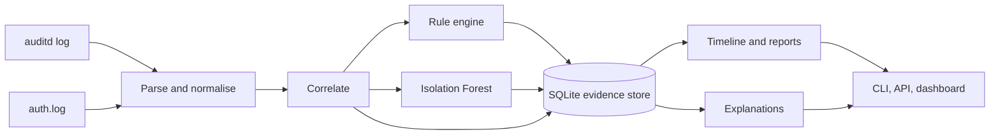

# LinuxGuard

[](https://github.com/qatada16/linuxguard/actions/workflows/ci.yml)


**Machine learning-assisted Linux intrusion detection and investigation system.**

LinuxGuard collects security-relevant events from the Linux audit subsystem (`auditd`) and authentication logs,
normalises and correlates them, detects suspicious behaviour with configurable rules and an Isolation Forest anomaly
detector, stores alerts with their supporting evidence, and helps analysts investigate through chronological
timelines, incident reports and optional natural-language explanations from a local or cloud language model.

The project's main contribution is a controlled comparison of rule-only detection with combined rule and machine
learning detection (see [Evaluation](#evaluation)).

> Information Security semester project, Department of Computer Science, FAST-NUCES Lahore.
> Group 17: Anees Hamid, Muhammad Qatada and Aliyan Bajwa. Instructor: Usman Aamer.

## Features

- **Event collection** from `audit.log` (raw and enriched formats, hex-encoded fields, multi-record events) and
  `auth.log`/syslog (RFC 3339 and BSD timestamps), from files or by following live logs with rotation support.
- **Normalisation and correlation** into a common event model: process execution, file access and modification,
  permission changes, authentication, privilege escalation, account management, network connections, kernel
  modules and audit configuration. Cross-source de-duplication, process-tree reconstruction and session linking.
- **Rule engine** with 23 default rules mapped to MITRE ATT&CK, supporting single-event, threshold (count or
  distinct values in a sliding window) and multi-step sequence rules defined in YAML.
- **Anomaly detection** with an Isolation Forest over engineered per-session activity features (volume, diversity,
  rarity relative to the baseline, time of day), a baseline range guard, explainable feature deviations and
  integrity-checked model files.
- **Evidence storage** in SQLite: events, alerts and ordered evidence links.
- **Investigation**: chronological timelines with surrounding context, triage status, and incident reports in
  Markdown, HTML and JSON with SHA-256 digests.
- **Explanations** in three modes: template-based (no AI), a local model through Ollama, or a cloud model API with
  explicit consent, data minimisation and redaction. Detection never depends on AI.
- **Interfaces**: command-line tool, REST API (FastAPI) and dashboard (Streamlit).
- **Evaluation harness** with a labelled synthetic data generator (24 attack and 6 benign-unusual scenarios), lab
  scripts for a real VM, and precision, recall, false-positive rate, detection delay and resource metrics.

## Architecture



Details: [docs/architecture.md](docs/architecture.md).

## Quick start

Requires Python 3.11 or newer.

```bash
git clone https://github.com/qatada16/linuxguard.git
cd linuxguard
python -m venv .venv && source .venv/bin/activate
pip install -e ".[all,dev]"
```

Try the full workflow on labelled synthetic logs:

```bash
linuxguard simulate --output data/baseline --seed 101 --days 3 --baseline
linuxguard simulate --output data/test --seed 5
linuxguard train --audit-log data/baseline/audit.log --auth-log data/baseline/auth.log \
    --passwd data/baseline/passwd --output models/isolation_forest.joblib
linuxguard ingest --mode hybrid --audit-log data/test/audit.log --auth-log data/test/auth.log \
    --passwd data/test/passwd
linuxguard alerts --severity critical
linuxguard show <alert-id>
linuxguard timeline <alert-id>
linuxguard report <alert-id> --format html --output reports/output/incident.html
linuxguard dashboard
```

To monitor a real host, install LinuxGuard on an Ubuntu VM with [`deploy/install.sh`](deploy/install.sh); see
[docs/deployment.md](docs/deployment.md).

## Command reference

| Command | Purpose |
| --- | --- |
| `linuxguard init-db` | Create the evidence database |
| `linuxguard ingest --audit-log F --auth-log F [--mode rules\|hybrid]` | Analyse log files and store events and alerts |
| `linuxguard monitor [--mode] [--from-start]` | Follow live logs and raise alerts |
| `linuxguard train --audit-log F --auth-log F [--output M]` | Train the anomaly baseline from benign logs |
| `linuxguard alerts [--severity] [--status] [--detector]` | List alerts |
| `linuxguard show ID` / `timeline ID` | Inspect an alert and its timeline (ID prefixes are accepted) |
| `linuxguard explain ID [--mode template\|local\|cloud]` | Explain an alert |
| `linuxguard report ID [--format markdown\|html\|json] [--output F]` | Generate an incident report |
| `linuxguard status ID open\|acknowledged\|resolved\|false_positive` | Triage an alert |
| `linuxguard simulate`, `linuxguard evaluate` | Generate labelled data and run the comparison |
| `linuxguard serve`, `linuxguard dashboard` | Start the REST API or the dashboard (bound to 127.0.0.1) |

Configuration is read from a YAML file passed with `--config` (see [config/linuxguard.yaml](config/linuxguard.yaml));
`LINUXGUARD_DATABASE`, `LINUXGUARD_MODE`, `LINUXGUARD_MODEL`, `LINUXGUARD_RULES` and
`LINUXGUARD_EXPLANATION_MODE` override individual settings.

## Detection

- **Rules:** brute force, password spraying, successful login after failures, credential store access,
  sudoers and passwd tampering, account creation and privileged group membership, execution from temporary
  directories, reverse shells, `curl | bash`, web shells, cron/systemd/SSH key persistence, setuid binaries,
  sudo root shells, kernel modules, audit and log tampering, discovery bursts and shell network connections.
  Full list and rule language: [docs/rules.md](docs/rules.md).
- **Anomaly detection:** 60-second windows per login session, 15 features, Isolation Forest trained on a benign
  baseline with a 99.5th percentile threshold plus a range guard. Anomaly alerts are kept separate from rule
  alerts and never claim that an intrusion occurred.

## Evaluation

Five seeds, each with three days of benign training data and one test day containing 48 attack cases (24 scenarios,
17 covered by rules and 7 not) and about 46 benign cases:

| Configuration | Recall | False-positive rate | Case precision | F1 | Mean delay | Time per event |
| --- | ---: | ---: | ---: | ---: | ---: | ---: |
| Baseline A: rules only | 0.708 | 0.105 | 0.876 | 0.783 | 10.5 s | 0.08 ms |
| Baseline B: rules + anomaly detection | **0.858** | 0.193 | 0.824 | **0.841** | 17.7 s | 2.97 ms |
| Isolation Forest only, no range guard | 0.075 | 0.092 | 0.429 | 0.127 | 57.6 s | 3.14 ms |

Adding anomaly detection found data exfiltration, internal scanning and mass file encryption in every run, and
cryptomining in most, none of which any rule covers. It also flagged package upgrades and some routine work sessions,
nearly doubling the false-positive rate. Slow attacks (beaconing implants, credential hunting, night-time privileged
commands) were missed by both configurations. Methodology, per-scenario results, discussion and threats to validity:
[docs/evaluation.md](docs/evaluation.md).

Live validation on Ubuntu (WSL) against a real OpenSSH server detected an SSH brute force (LG-AUTH-001) and the
successful login that followed it (LG-AUTH-003) directly from `/var/log/auth.log` while monitoring.

## Security and privacy

The tool escapes attacker-controlled content in reports, uses parameterised SQL, verifies model integrity before
loading, binds its interfaces to localhost, supports API keys, stores evidence with owner-only permissions, and runs
under a hardened systemd unit. Cloud explanations are off by default and require consent, redaction and disclosure.
See [docs/security.md](docs/security.md).

## Development

```bash
pytest              # 157 tests
ruff check src tests
ruff format --check src tests
```

```
src/linuxguard/
├── collection/      audit and syslog parsing, file following
├── processing/      normalisation, user resolution, correlation
├── detection/       rule engine, anomaly detection, pipeline
├── storage/         SQLite evidence store
├── investigation/   timelines and reports
├── explanation/     template, local and cloud explanations, redaction
├── evaluation/      synthetic data, labelling, metrics, comparison runner
├── api/             FastAPI backend
├── dashboard/       Streamlit dashboard
├── cli/             command-line interface
└── resources/       default detection rules
```

## Scope and limitations

LinuxGuard monitors a single Linux host. It is not an antivirus, malware sandbox, SIEM, multi-host platform or
automated response system. The evaluation uses simulated activity; anomaly detection is expected to produce more
false positives on real hosts and needs a representative baseline. The kernel audit subsystem is unavailable inside
containers and WSL, so full collection requires a virtual or physical machine.

## References

1. Linux Audit Project, *Linux Audit Userspace Documentation*. https://github.com/linux-audit/audit-userspace
2. scikit-learn developers, *IsolationForest*. https://scikit-learn.org/stable/modules/generated/sklearn.ensemble.IsolationForest.html
3. NIST SP 800-92, *Guide to Computer Security Log Management*. https://csrc.nist.gov/pubs/sp/800/92/final
4. NIST SP 800-86, *Guide to Integrating Forensic Techniques into Incident Response*. https://csrc.nist.gov/pubs/sp/800/86/final
5. MITRE ATT&CK for Enterprise. https://attack.mitre.org

## License

[MIT](LICENSE)
