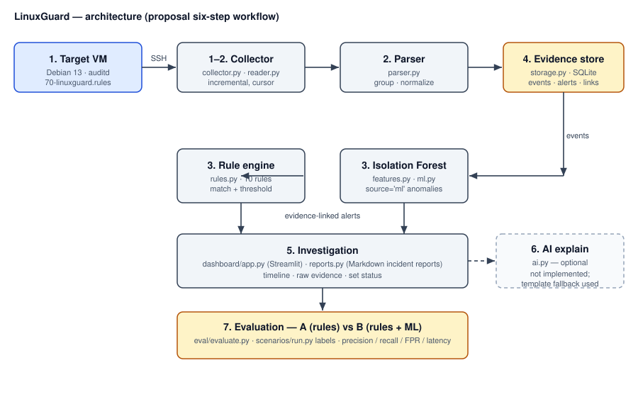
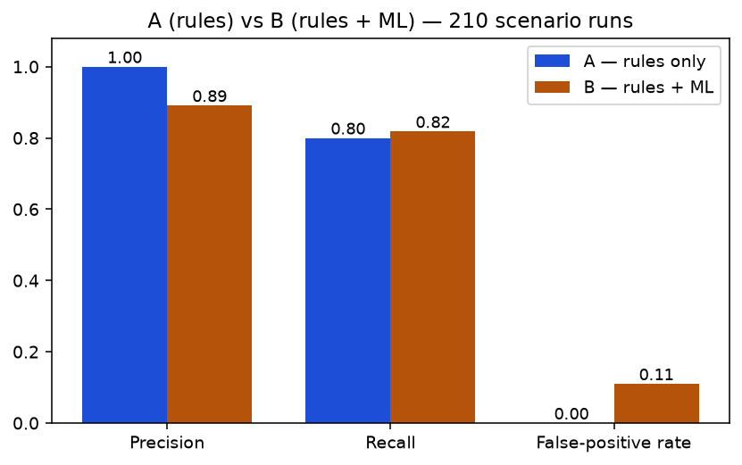
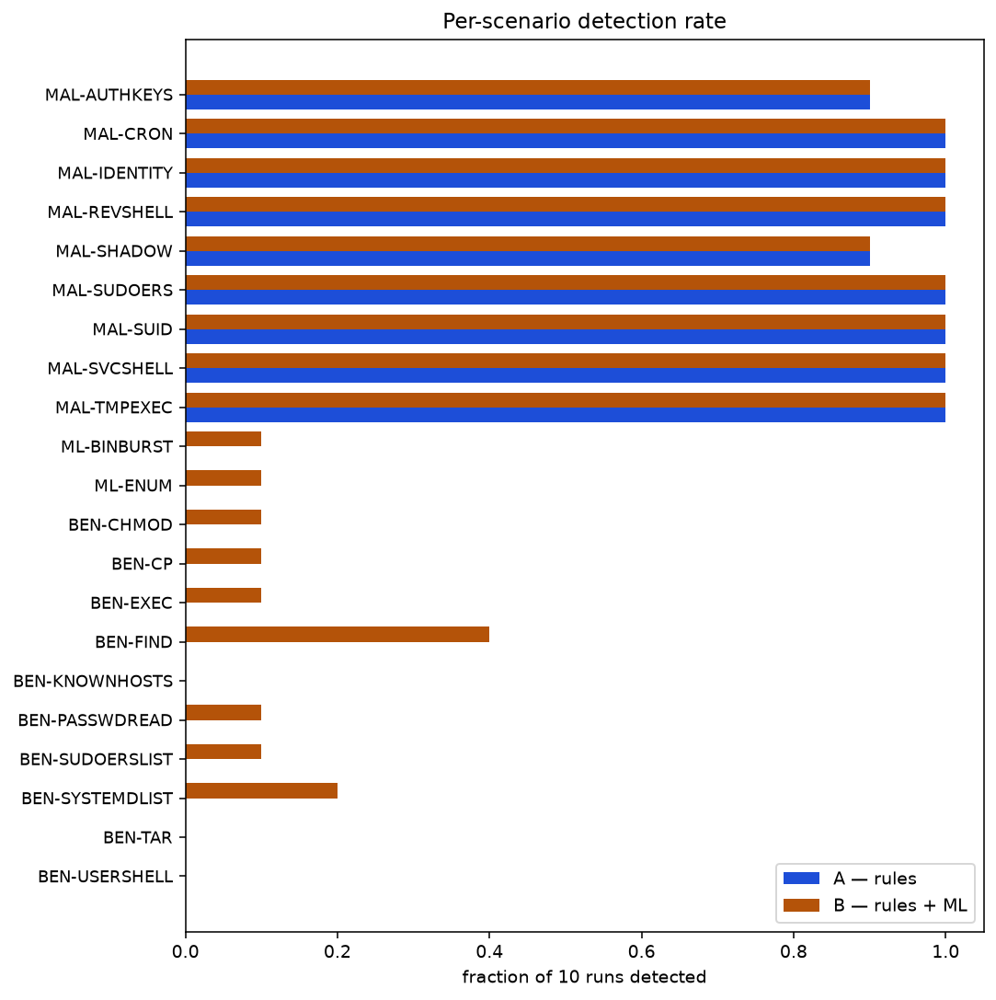
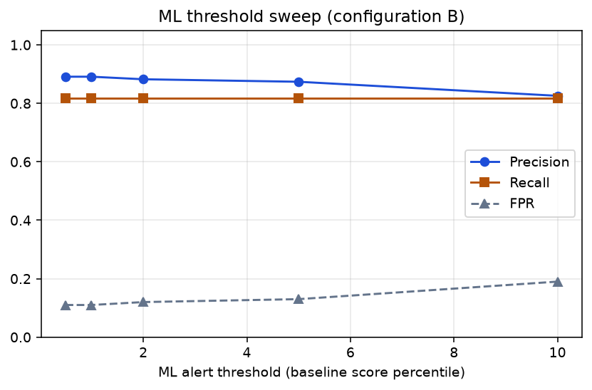

# LinuxGuard — Machine Learning-Assisted Linux Intrusion Detection and Investigation System

**Group 17 — Final Technical Report**
National University of Computer and Emerging Sciences (FAST-NUCES), Lahore — Department of Computer Science
Course Instructor: Usman Aamer

| Team member | Roll number |
|---|---|
| Anees Hamid | 23L-0671 |
| Muhammad Qatada | 23L-0998 |
| Aliyan Bajwa | 23L-2512 |

---

## 1. Abstract

LinuxGuard is a lightweight security monitoring and investigation prototype for a single Linux
host. It collects Linux Audit telemetry from an isolated target VM, normalizes it into
structured events, and applies two complementary detectors: a small set of configurable rules
and an Isolation Forest anomaly detector. Alerts are stored with the exact audit events that
triggered them, presented in a Streamlit dashboard with a chronological timeline, and exported
as template-based incident reports — all without any AI dependency.

The project's primary contribution is a controlled comparison of **rule-only detection (A)**
against **rule-plus-ML detection (B)** on 210 labelled scenario runs. **Rules alone achieved
perfect precision (1.00) at 0.80 recall with zero false positives; adding the Isolation Forest
raised recall only marginally (to 0.82) while introducing false positives (precision 0.89,
false-positive rate 0.11).** Across a threshold sweep, ML recall never improved beyond 0.82,
and looser thresholds only added false positives. On this prototype's limited, scripted
baseline the ML component did **not** clearly improve detection — a result we report honestly,
as the proposal required.

## 2. Objectives and how they were met

| # | Proposal objective | Status | Component |
|---|---|---|---|
| 1 | Collect security-relevant events via Linux Audit | Done | `collector.py`, `reader.py`, `config/audit/linuxguard.rules` |
| 2 | Normalize and correlate events into a structured format | Done | `parser.py`, `storage.py` (`related_events`) |
| 3 | Configurable rules for predefined suspicious behaviour | Done | `rules.py`, `config/rules.yaml` (10 rules) |
| 4 | Isolation Forest on engineered features | Done (provisional baseline) | `features.py`, `ml.py` |
| 5 | Store alerts + evidence, chronological timeline | Done | `storage.py`, `dashboard/app.py` |
| 6 | Incident reports, optional AI explanations | Done; reports + **local AI explanations** (Ollama/Gemma) with template fallback; cloud off | `reports.py`, `ai.py` |
| 7 | Compare rule-only vs rule+ML with metrics | Done | `eval/evaluate.py`, `eval/sweep.py`, `scenarios/run.py` |

## 3. Architecture

LinuxGuard follows the proposal's six-step workflow, implemented as small Python modules over a
local SQLite database. The target VM runs `auditd`; everything else runs on the host.



1. **Event collection** — `collector.py`/`reader.py` read `/var/log/audit/audit.log` over SSH
   incrementally, tracking a cursor (device, inode, offset, content fingerprint) and handling
   log rotation. Evidence is flushed before the cursor advances, so a crash is detected as a
   size mismatch rather than silently skipping records.
2. **Event processing** — `parser.py` groups raw records by host, timestamp and serial into one
   normalized event each, decoding hex fields, reassembling `EXECVE` arguments, resolving user
   identity from `auid`/`uid`, and preserving every `PATH` entry and the raw bytes as evidence.
3. **Detection** — `rules.py` evaluates ten configurable rules (single-event `match` and
   sliding-window `threshold`); `ml.py` scores fixed per-user windows with an Isolation Forest.
   Rule and ML findings stay distinguishable (`source='rule'` vs `source='ml'`; ML alerts say
   "unusual activity", never "intrusion").
4. **Evidence storage** — `storage.py` (`EvidenceStore`) keeps events, alerts, and the
   many-to-many evidence links in SQLite, with stable event identity `(host, ts, serial)` and
   fingerprinted alerts so replaying evidence produces no duplicates.
5. **Investigation** — `dashboard/app.py` (Streamlit) shows alert counts, a filterable alert
   list with status setting, a correlated timeline (events sharing pid/ppid/user/src_ip within
   ±N minutes, evidence highlighted) and raw audit lines; `reports.py` exports a Markdown
   incident report.
6. **Optional AI explanation** — `ai.py` explains an alert in plain English via a local Ollama
   model (Gemma), with a strict evidence-only prompt and a guaranteed template fallback; cloud
   mode is intentionally off. The dashboard shows which mode produced each explanation.

Detection is a pure function of stored events, so it is deterministic and replay-safe. Because a
batch parser cannot tell when the newest live event is complete, detection applies a **settle
horizon**: events newer than a configurable window are deferred until a later poll, and offline
captures are run with `--settled`.

## 4. Setup and reproducibility

**Host** (Arch Linux, this machine): Python 3.12 via `uv`; dependencies pinned in
`code/uv.lock` (`requirements.txt` is also exported for reference). From `code/`:

```bash
uv sync --locked --inexact
uv run --locked --inexact python -m linuxguard check-config
uv run --locked --inexact pytest        # 135 tests
```

**Target VM**: Debian 13 (`linuxguard-target`, `192.168.122.164`) under KVM/QEMU, reached by a
dedicated SSH key (alias `lg`). `auditd` is configured from `config/audit/linuxguard.rules`
(installed as `/etc/audit/rules.d/70-linuxguard.rules`) with seven keys covering process
execution, mode changes, identity/sudoers/SSH/persistence file activity, and shadow reads.
Two libvirt snapshots exist: `clean-install` and `rules-loaded` (rules + SSH/log access). The
unprivileged collector user (`bonzo`) is in group `adm` to read the audit log without root.
Full connection and setup detail is in [AGENT_HANDOFF.md](AGENT_HANDOFF.md).

**End-to-end commands** (exact commands that produced the results below):

```bash
# collect + normalize + store (rules only)
uv run --locked --inexact python -m linuxguard pipeline --file CAPTURE --output OUT --state ST \
  --database test.db --host linuxguard-target --passwd-file target-passwd --detect --settled

# train the anomaly detector on a normal-only baseline, then score rules + ML
uv run --locked --inexact python -m linuxguard train --database baseline.db --model data/model.joblib
uv run --locked --inexact python -m linuxguard pipeline --file CAPTURE ... --detect --model data/model.joblib --settled

# labelled scenarios on the VM (root), then evaluate A vs B and sweep the ML threshold
sudo python3 scenarios/run.py --repeats 10 --gap 10
python eval/evaluate.py --test-db test.db --labels labels.csv
python eval/sweep.py --baseline-db baseline.db --test-db test.db --labels labels.csv --model data/model.joblib

# investigation dashboard
uv run --locked --inexact streamlit run linuxguard/dashboard/app.py
```

Raw audit captures, the trained model, and databases are **Git-ignored** (they can contain
sensitive host detail); the figures and the tables in this report are the shareable record.
Figures regenerate from the committed scripts: `python eval/make_figures.py`.

## 5. Evaluation and results

**Test data.** `scenarios/run.py` ran 21 scenarios × 10 repetitions = **210 labelled runs**
(110 malicious, 100 benign) inside the VM, each action inert, reversible and loopback-only, with
labels written from the catalogue (never from detector output). `auditctl -s` reported
`enabled 1 / lost 0` before and after, so no records were dropped. The **training baseline** is
separate: ~1 hour of scripted benign activity (59 feature windows) — a deliberately modest,
*provisional* baseline.

Nine malicious scenarios target a specific rule (R01–R10); two (`ML-ENUM` broad filesystem
enumeration, `ML-BINBURST` many distinct binaries) are deliberately **not** rule-targeted, to
see whether ML adds value where rules are silent. An alert is attributed to the scenario run
that was executing when it fired (nearest start). A malicious run with ≥1 alert is a true
positive; a benign run with any alert is a false positive.

### 5.1 Rules (A) vs rules + ML (B)



| Configuration | Precision | Recall | False-positive rate | TP | FP | FN | Latency (median / max) |
|---|---|---|---|---|---|---|---|
| **A — rules only** | **1.00** | 0.80 | **0.00** | 88 | 0 | 22 | 0.0 s / 0.5 s |
| **B — rules + ML** | 0.89 | 0.82 | 0.11 | 90 | 11 | 20 | 0.0 s / 3.3 s |

Rules caught every rule-targeted scenario with **zero false positives** across 100 benign runs,
and (by design) missed the two ML-only scenarios entirely — those 20 runs plus two near-miss
runs (shadow-read and authorized-keys at 9/10) are the 22 false negatives. Adding ML recovered
**only 2** of the 20 ML-target runs (ENUM 1/10, BINBURST 1/10) while adding **11 benign false
positives**, so precision fell 1.00→0.89 and the false-positive rate rose to 0.11. Detection
latency is effectively immediate: rules fire on the triggering event itself.

### 5.2 Per-scenario detection



| Scenario | Label | A caught | B caught | Fired |
|---|---|---|---|---|
| MAL-SUDOERS (R03) | malicious | 10/10 | 10/10 | R03 (+ml) |
| MAL-IDENTITY (R02) | malicious | 10/10 | 10/10 | R02 (+ml) |
| MAL-SUID (R10) | malicious | 10/10 | 10/10 | R10 |
| MAL-TMPEXEC (R07) | malicious | 10/10 | 10/10 | R07 (+ml) |
| MAL-SVCSHELL / MAL-REVSHELL (R06) | malicious | 10/10 | 10/10 | R06 (+ml) |
| MAL-CRON (R08) | malicious | 10/10 | 10/10 | R08 (+ml) |
| MAL-SHADOW (R01) | malicious | 9/10 | 9/10 | R01 |
| MAL-AUTHKEYS (R09) | malicious | 9/10 | 9/10 | R09 |
| ML-ENUM / ML-BINBURST | malicious | 0/10 | 1/10 | ml only |
| 10 benign scenarios | benign | 0/10 | 0–4/10 | ml false positives |

### 5.3 ML threshold sweep



| Threshold (baseline percentile) | ML alerts | Precision | Recall | FPR |
|---|---|---|---|---|
| 0.5 % | 20 | 0.89 | 0.82 | 0.11 |
| 1.0 % | 21 | 0.89 | 0.82 | 0.11 |
| 2.0 % | 23 | 0.88 | 0.82 | 0.12 |
| 5.0 % | 45 | 0.87 | 0.82 | 0.13 |
| 10.0 % | 58 | 0.83 | 0.82 | 0.19 |

Recall is **flat at 0.82 at every threshold** — loosening the cutoff never catches more attacks,
it only adds benign false positives. There is no operating point at which ML improves on rules
for this baseline.

### 5.4 Resource consumption

On the host, scoring the 35-minute test capture (3,029 events) took **~1.7 s** end to end
(parse 0.25 s, store 0.10 s, rules 1.11 s, ML 0.27 s) at a peak of **~256 MiB** RSS — almost all
of it the scikit-learn/NumPy import, not the detection itself. Training on the 59-window
baseline took **0.12 s**. On the VM, `auditd` used **~2.3 MiB** RSS at ~0 % CPU idle. Database
sizes: `test.db` 13 MiB (full normalized events + raw evidence), `baseline.db` 3.3 MiB, model
0.6 MiB. The heavy components (ML, dashboard) run on the host; the VM footprint is negligible —
consistent with the proposal's lightweight, CPU-only design.

### 5.5 AI explanation quality (local Gemma)

On real alerts, the local model produced clear, grounded explanations: for the shadow-read rule
alert it noted that `cat` opened `/etc/shadow`, "typically only accessed by privileged
processes"; for an ML window it summarised the tar/gzip/shell executions and the sshd shadow read
as unusual activity. No invented files, users or IPs were observed, and it suggested no commands.
First call ~37 s (model load), ~5 s thereafter. The template fallback was confirmed for both an
unreachable endpoint and an empty model response — detection and reporting are unchanged whether
AI is on or off.

## 6. Limitations

- **Single host, small and scripted scenario set.** 21 scenario types; actions are authorized,
  predefined and inert, not real adversaries or malware.
- **Provisional ML baseline.** The Isolation Forest was trained on ~1 hour of *scripted*
  benign activity (59 windows), not representative human use. On a uniform/thin baseline the
  detector flags ordinary windows and misses real anomalies; a richer, longer, more varied
  normal-only baseline is required before drawing firm conclusions about ML.
- **Audit-rule coverage and known rule gaps.** Detection only sees what the seven audit keys
  capture. Documented rule gaps: an interpreted script run as `sh /tmp/x.sh` is not an `execve`
  target (so R07 relies on direct execution); `openat` paths relative to a directory fd are not
  resolved; only the enriched syscall name or a small x86-64 number table is decoded (32-bit
  calls may be missed); `/etc/ssh/sshd_config.d` is not watched. R06's "shell from /tmp" is
  covered by R07, and R10 fires on any successful SUID set (a "new file" cannot be proven from a
  single event).
- **Anomaly ≠ intrusion.** ML alerts indicate unusual activity only; they are advisory and kept
  distinct from rule alerts.
- **AI explanations are local only.** The local mode (Ollama/Gemma) is implemented with a strict
  evidence-only prompt and a guaranteed template fallback; cloud AI is intentionally off (it would
  require consent, redaction and disclosure per the proposal). The explanation is advisory text and
  never influences detection. Quality is bounded by the local model; the fallback always works.
- **Operational lesson.** An early version of the scenario runner shelled out to `ssh-keygen`,
  which hung and timed out; its cleanup then deleted the real `authorized_keys`, briefly breaking
  key-based SSH. This was fixed (generate the key line in-process, and never let a cleanup touch
  a file the scenario did not modify) and a regression test added — a concrete reminder that
  teardown code is as safety-critical as the action it reverses.

## 7. Conclusion and future work

LinuxGuard delivers a working, evidence-based Linux detection and investigation pipeline, and —
its main contribution — a controlled, honest comparison of rules against rules + ML. On this
prototype, **rule-based detection was both strong and precise, and the Isolation Forest did not
add value**: it recovered only two attacks rules missed, at the cost of eleven false positives,
with no better operating point available. This is a legitimate and useful result: it shows that
anomaly detection is only as good as its baseline, and that a small set of well-grounded rules
can be a high-precision foundation.

Future work: collect a longer, more varied normal-only baseline and re-evaluate the Isolation
Forest; extend the AI explanations to an approved cloud model (with consent and redaction) if the
course permits; broaden the scenario set and audit-rule coverage; and measure under sustained load.

## References

1. Linux Audit Project — *Linux Audit Userspace Documentation.* https://github.com/linux-audit/audit-userspace
2. Scikit-learn Developers — *IsolationForest Documentation.* https://scikit-learn.org/stable/modules/generated/sklearn.ensemble.IsolationForest.html
3. NIST — *Guide to Computer Security Log Management,* SP 800-92. https://csrc.nist.gov/pubs/sp/800/92/final
4. NIST — *Guide to Integrating Forensic Techniques into Incident Response,* SP 800-86. https://csrc.nist.gov/pubs/sp/800/86/final
