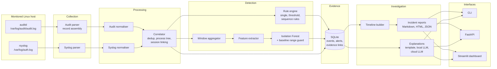

# Architecture

LinuxGuard is a single-host monitoring and investigation pipeline written in Python. Every stage is a separate
package with a narrow interface, so stages can be tested in isolation and replaced independently.

## Packages

| Package | Responsibility |
| --- | --- |
| `linuxguard.domain` | `SecurityEvent` and `Alert` data model shared by every stage. |
| `linuxguard.collection` | Parsing raw `audit.log` records (including hex-encoded fields, nested `msg='…'` payloads and the enriched log format), grouping records into events by serial number, parsing RFC 3339 and BSD syslog lines, and tailing files with rotation support. |
| `linuxguard.processing` | Converting audit events and syslog messages into normalised `SecurityEvent`s, resolving users from `/etc/passwd`, decoding socket addresses, de-duplicating events reported by both sources, linking processes to their parents and assigning correlation identifiers. |
| `linuxguard.detection.rules` | YAML rule language, validation and a streaming rule engine. |
| `linuxguard.detection.anomaly` | Activity windows, feature engineering, the Isolation Forest detector and integrity-checked model persistence. |
| `linuxguard.detection.pipeline` | Combines both detectors and turns matches and findings into alerts. |
| `linuxguard.storage` | SQLite schema and the `EvidenceStore` repository. |
| `linuxguard.investigation` | Chronological timelines and incident reports. |
| `linuxguard.explanation` | Template, local (Ollama) and cloud explanations, redaction and fallback handling. |
| `linuxguard.evaluation` | Synthetic labelled data generator, case labelling, metrics and the comparison runner. |
| `linuxguard.application` | Facade used by the CLI, API and dashboard. |
| `linuxguard.cli`, `linuxguard.api`, `linuxguard.dashboard` | User interfaces. |

## Event model

Every source is normalised into a `SecurityEvent` with a category (`process_execution`, `file_access`,
`file_modification`, `permission_change`, `authentication`, `login`, `privilege_escalation`,
`account_management`, `network_connection`, `kernel_module`, `audit_configuration`, `service`, `other`), an
action, an outcome and the actor, process, file and network attributes that apply. The event identifier is a
SHA-256 digest of the host, source, record identifier and action, so re-ingesting the same log is idempotent.

## Correlation

* **Cross-source de-duplication.** On Ubuntu an SSH or sudo authentication is written both to the audit log
  (`USER_AUTH`) and to `auth.log`. Events of the same category and outcome from different sources within two
  seconds are paired one-to-one; the duplicate is dropped and its richer attributes (for example the real user
  name of an invalid SSH user) are merged into the kept event.
* **Process tree.** The executable of every `execve` is remembered per PID, so later events receive their
  `parent_executable` (used, for example, to detect shells spawned by PHP-FPM). In live mode the parent is also
  resolved through `/proc/<ppid>/exe` for processes started before LinuxGuard.
* **Correlation identifiers.** Events share an identifier when they belong to the same audit session
  (`ses`), remote address or user. Timelines use it to show the activity surrounding an alert.

## Rule engine

Rules are YAML documents (see [rules.md](rules.md)). Three evaluator types are supported:

* **Single-event** rules match one event and are suppressed for 60 seconds per correlation identifier to avoid
  alert floods (for example `auditctl -D` removing many rules at once).
* **Threshold** rules count matching events, or distinct values of a field, inside a sliding window per group.
* **Sequence** rules require ordered steps, each with a minimum count, within a time limit per group.

## Anomaly detection

Events are grouped into 60-second activity windows per login session (`user@session:N`), per remote address for
authentication events, or per user for processes without a session. Fifteen engineered features describe each
window:

| Group | Features |
| --- | --- |
| Activity volume | process executions, file changes, network connections, connections to public addresses, failed authentications, privileged actions, security-relevant changes |
| Diversity | distinct executables, network destinations and modified directories |
| Novelty | rarity of the least common executable, destination, port and modified directory relative to the baseline (`-log p` with Laplace smoothing) |
| Context | interactive activity outside working hours |

An Isolation Forest (scikit-learn, 100 trees, 256 samples per tree) is trained on windows from a benign baseline.
The alert threshold is the 99.5th percentile of the baseline anomaly scores.

Isolation Forest assigns a point that lies beyond the training range of a feature roughly the same isolation depth
as the most extreme training points, so extreme values in a single feature (for example 60 hosts contacted in one
minute) are not always ranked above ordinary but multi-dimensional benign activity. LinuxGuard therefore adds a
**baseline range guard**: a window is also reported when a volume or diversity feature exceeds
`max(2 × baseline maximum, baseline maximum + 5)`. The evaluation reports results with and without the guard.

Anomaly alerts list the features that deviate most from the baseline mean (standardised deviation) and always
state that an anomaly is unusual behaviour rather than proof of an intrusion. Rule alerts and anomaly alerts are
kept separate (`detector = rule | anomaly`) and both link to their evidence events.

## Evidence storage

SQLite (WAL mode, foreign keys, file mode `0600`) stores three tables: `events`, `alerts` and `alert_evidence`
(ordered links between alerts and events). All queries are parameterised.

## Investigation and reporting

The timeline for an alert contains its evidence events plus the events that share their correlation identifier or
user within five minutes before and after the alert, each marked as evidence or context and linked to any other
alerts that reference it. Reports are produced in Markdown, HTML and JSON with the detection basis, ATT&CK
mapping, affected entities, recommended actions, timeline and raw records. The CLI writes a SHA-256 digest next to
every exported report so its integrity can be verified later.

## Explanations

| Mode | Behaviour |
| --- | --- |
| `template` (standard) | Rule-specific explanation templates and a feature-based description for anomalies. No language model is used. |
| `local` | Sends the alert summary and up to 20 evidence events to a local Ollama model. Redaction is optional. |
| `cloud` | Sends redacted evidence to an OpenAI-compatible chat completion endpoint only after explicit consent. |

Language-model output is only displayed, never executed. If a model is unavailable, times out or consent is
missing, the template explanation is returned with the reason recorded in the provider label.
